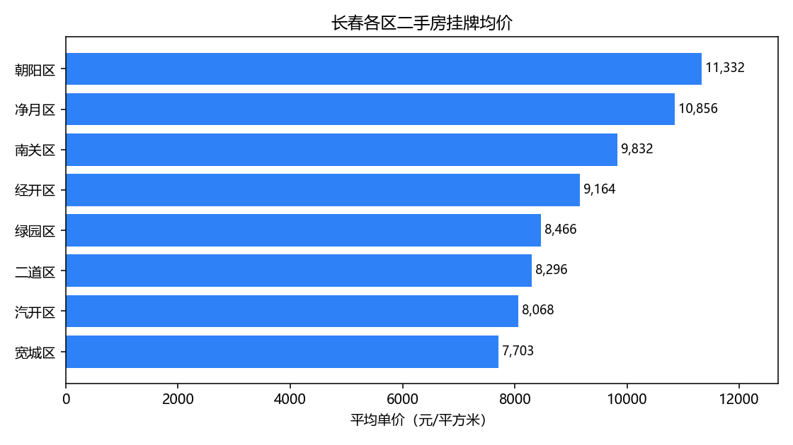

# changchun-housing

长春二手房挂牌数据分析：从一张「脏」CSV，到一份能讲给别人听的数据报告。

**流程完整、能跑通、有测试**——但 `reports/report.md` 里的「结论」故意留空，那是你要自己写的东西。


---

## 这个项目要回答什么

1. 哪个区最贵、哪个区房源最多？
2. 小户型单价高，还是大户型高？
3. 低楼层、高楼层、顶楼，单价差多少？
4. 房龄对价格的影响有多大？
5. 哪些小区挂牌量最大（= 最容易出手）？

对应 `sql/questions.sql` 里的五段 SQL，加一段就会被自动跑到。

---

## 30 秒跑起来

```bash
git clone https://github.com/Wang-xinyu-2007/changchun-housing.git
cd changchun-housing
python -m pip install -r requirements.txt

python -m src.demo_data    # 生成示例数据（840 行，带脏数据）
python -m src.pipeline     # 清洗 → 入库 → 跑 SQL → 出报告

# 打开 reports/report.md
```

Windows 上 `python3` 不存在的话，用 `python`；或者 `make all PYTHON=python`。

---

## 它长什么样



终端输出：

```text
原始行数    840
清洗后行数  780（保留 92.9%）
数据库      data/processed/housing.db
查询        5 条
报告        reports/report.md
```

报告里每个问题都是一张表 + 一张图，例如：

| 区域 | 房源数 | 均价 | 最低价 | 最高价 |
| --- | --- | --- | --- | --- |
| 朝阳区 | 122 | 11,332 | 8,767 | 13,431 |
| 净月区 | 119 | 10,856 | 8,344 | 13,221 |
| 南关区 | 118 | 9,832 | 7,829 | 12,471 |
| 宽城区 | 66 | 7,703 | 6,433 | 9,166 |

> 上面是**示例数据**跑出来的结果，用来验证流程，不代表真实行情。

---

## 清洗：这个项目最值钱的部分

真实挂牌数据一定长这样，而面试官问得最多的就是「你清洗时遇到最大的问题是什么」。

| 你拿到的 | 处理成 | 为什么 |
| --- | --- | --- |
| `朝阳`、`朝阳 `、`朝阳区` | `朝阳区` | 同一个区三种写法，不统一就没法分组 |
| `85万`、`85.5万` | `85.0` | 带单位的字符串，`float()` 直接报错 |
| `850000` | `85.0` | 有人按「元」填，直接比会差一万倍 |
| `89.5㎡`、`90平米` | `89.5`、`90.0` | 面积带单位，要先剥掉 |
| 同一个 `listing_id` 出现两次 | 只留第一条 | 中介换价格重发，算两次会拉高挂牌量 |
| 面积 9999、总价 99999 | 丢弃 | 录入错误，留着会毁掉均值 |
| 单价 0 或空 | `总价 ÷ 面积` 重算 | 比直接丢行更划算：能救回 14 行 |

清洗顺序也是有讲究的：**先统一格式，再去重，再按业务规则过滤，最后才补算缺失值**。
顺序错了会出现「用脏数据算出脏单价，再拿脏单价去过滤」的连锁错误。

每条规则都有单元测试（`tests/test_clean.py`），改规则的时候跑一下就知道有没有误伤。

---

## 为什么用 SQL，而不是 pandas 一把梭

因为真实工作里分析师 80% 的时间在写 SQL，而且：

- **问什么**（`sql/questions.sql`）和**怎么算**（`src/store.py`）分开，改问题不用动代码；
- 加一个问题 = 复制一段 SQL，pipeline 自动发现并跑；
- 同样的逻辑换成 BI 工具、换数据库都还能用。

`pandas` 负责它擅长的部分：清洗、类型转换、画图。

---

## 目录结构

```text
changchun-housing/
├── src/
│   ├── config.py      # 路径 + 业务规则（所有"魔法数字"都在这里）
│   ├── clean.py       # 脏数据清洗（最值得读的文件）
│   ├── store.py       # 写 SQLite + 执行 SQL
│   ├── report.py      # 画图 + 生成 Markdown
│   ├── demo_data.py   # 生成示例数据
│   └── pipeline.py    # 串起来
├── sql/questions.sql  # 五个业务问题
├── tests/             # 23 个单元测试
├── data/raw/          # 原始数据（示例数据已提交）
├── reports/           # 报告 + 图（生成物，也提交了，方便直接看）
├── Makefile
└── requirements.txt
```

---

## 换成你自己的数据（重点）

这份仓库是**脚手架**，示例数据只是为了让你先跑通。换成真实数据只要三步：

1. 把 CSV 放到 `data/raw/listings.csv`，列名对齐（列名见 `demo_data.COLUMNS`）；
2. 改 `src/config.py`：`DISTRICTS` 换成你关心的区、`AREA_MIN/MAX` 这类区间按当地行情调；
3. `python -m src.pipeline`，报告和图表会自动更新。

**数据从哪来？** 贝壳/链家的小区列表页、各地住建局公开数据、Kaggle 上的房价数据集都行。
爬数据前先看对方 robots.txt 和用户协议，只取公开列表页、控制频率。

---

## 你要接着做的 5 件事

这个仓库交付的是「流程」，`reports/report.md` 第 3 节还是空的。按顺序做：

1. **换成真实数据**（哪怕只有 200 行）——示例数据不构成作品；
2. **写 3 条结论**，每条都要「一句话 + 一个数字 + 一个解释」，例如：
   *朝阳区均价 11,332 元/㎡，比宽城区高 47%，可能和学区与新房供给有关；*
3. **自己加一个 SQL 问题**——比如「按房龄和面积交叉分组，看哪类房子最抗跌」；
4. **加一个维度**：学区、地铁距离、装修，任选一个能显著区分价格的因素；
5. **把 README 的图和数据换成你的**——面试官会点开看，图是你的，说服力才是真的。

---

## 已知局限

- 挂牌价 ≠ 成交价，真实成交通常比挂牌低 5%~10%；
- 只有截面数据，没有时间序列，判断不了涨跌；
- 学区、地铁、装修这些真正影响价格的因素没有进入数据；
- 异常值用固定区间过滤，可能误伤真实的极端房源（比如别墅）。

**这些限制写进报告，是加分项而不是减分项**——说明你知道自己的分析边界在哪。

---

## 测试

```bash
python -m unittest discover -s tests -v   # 23 个用例
```

覆盖：金额单位换算、区名归一、去重、异常值过滤、单价重算、SQL 可执行、报告表格格式。
GitHub Actions 会在每次 push 时跑一遍测试 + 完整 pipeline。

---

## 许可

[MIT](LICENSE)
