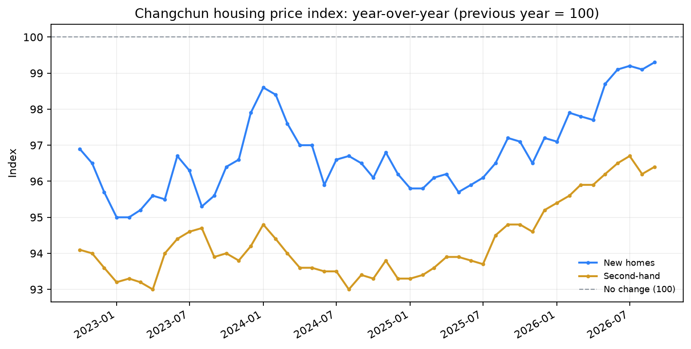
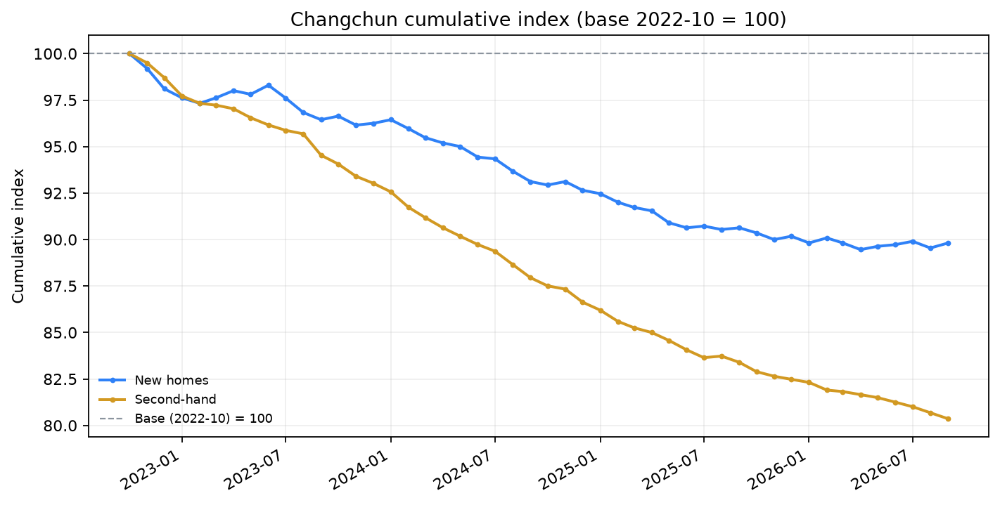
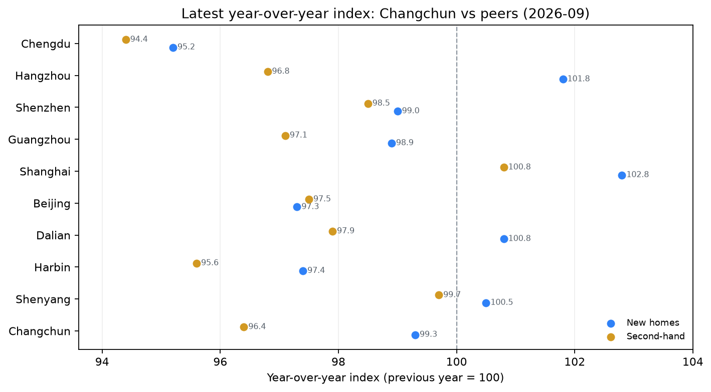

# 长春房价指数：国家统计局 70 城数据

> 数据来源：国家统计局：70 个大中城市商品住宅销售价格指数，[最新发布页](https://www.stats.gov.cn/sj/zxfbhjd/202610/t20261019_1965609.html)
>
> 覆盖 **2022-10 至 2026-09**，**48** 个月、70 个城市、2 个市场；最近更新：2026-10-31
>
> 指数口径：环比为「上月 = 100」，同比为「上年同月 = 100」，年内累计为「上年同期 = 100」。**它不是成交均价，也不代表单个小区或户型。**

## 1. 最新快照

**2026-09，长春：**

| 市场 | 环比 | 同比 | 年内累计 | 同比排名 |
| --- | --- | --- | --- | --- |
| 新房 | +0.3% | -0.7% | -1.6% | 9 / 70 |
| 二手房 | -0.4% | -3.6% | -3.9% | 17 / 70 |

新房环比 **+0.3%**、同比 **-0.7%**；二手房环比 **-0.4%**、同比 **-3.6%**。

同月 70 城中位数：新房同比 96.6、二手房同比 95.0。

新房同比比二手房高 **+2.9 个指数点**，环比差为 **+0.7 个指数点**；短期和同比层面，新房都强于二手房。

## 2. 长春新房与二手房走势



从 2022-10 到 2026-09，新房和二手房的同比走势见上图；100 是「与上年同月持平」的分界线。

与 12 个月前（2025-09）相比，新房同比从 97.2 变为 99.3，二手房同比从 94.8 变为 96.4。



把每月的环比指数连乘起来（基期 2022-10 = 100），到 2026-09 新房累计指数为 **89.8**，二手房为 **80.4**。

累计指数用来描述「相对基期涨跌了多少」，仍然是指数口径，不能直接换算成某个小区的成交价。

## 3. 全国与同类城市对比



| 城市 | 新房同比 | 二手房同比 | 新房环比 | 二手房环比 |
| --- | --- | --- | --- | --- |
| 长春 | -0.7% | -3.6% | +0.3% | -0.4% |
| 沈阳 | +0.5% | -0.3% | +0.0% | +0.0% |
| 哈尔滨 | -2.6% | -4.4% | -0.2% | -0.4% |
| 大连 | +0.8% | -2.1% | +0.2% | +0.1% |
| 北京 | -2.7% | -2.5% | -0.2% | +0.1% |
| 上海 | +2.8% | +0.8% | +0.2% | +0.5% |
| 广州 | -1.1% | -2.9% | +0.2% | +0.1% |
| 深圳 | -1.0% | -1.5% | +0.3% | +0.2% |
| 杭州 | +1.8% | -3.2% | +0.1% | -0.3% |
| 成都 | -4.8% | -5.6% | -0.3% | -0.5% |

在 70 个城市中，长春新房同比排名 **9/70**，二手房同比排名 **17/70**。排名只描述当前截面，不代表长期趋势。

## 4. 数据里的结论

1. **最新一个月：新房环比 +0.3%，二手房环比 -0.4%。** 新房环比比二手房高 +0.7 个指数点。
2. **同比层面二手房调整更深：** 新房同比 -0.7%，二手房同比 -3.6%，相差 +2.9 个指数点。
3. **长春新房同比在 70 城中排第 9，二手房排第 17。** 全国中位数分别为 96.6 和 95.0。
4. **二手房：在本数据覆盖期内连续 48 个月同比下降（数据自 2022-10 起）。** 这说明二手房同比在最近一段时间持续低于 100，而不是单月波动。
5. **自 2022-10 以来，新房累计 -10.2%，二手房累计 -19.6%。** 这说明两个市场的走势分化是累积形成的，不只发生在最新一个月。

> 这些结论是**指数层面的描述**，不是因果解释。要解释为什么，需要成交量、收入、人口、土地供给、政策等数据；单看价格指数无法回答。

## 5. SQL 问题

### Q1. 长春最新快照

| month | market | mom_index | yoy_index | ytd_index |
| --- | --- | --- | --- | --- |
| 2026-09 | new | 100.3 | 99.3 | 98.4 |
| 2026-09 | second_hand | 99.6 | 96.4 | 96.1 |

### Q2. 长春近 12 个月走势

| month | market | mom_index | yoy_index | ytd_index |
| --- | --- | --- | --- | --- |
| 2025-10 | new | 99.7 | 97.1 | 96.2 |
| 2025-10 | second_hand | 99.4 | 94.8 | 94.0 |
| 2025-11 | new | 99.6 | 96.5 | 96.3 |
| 2025-11 | second_hand | 99.7 | 94.6 | 94.0 |
| 2025-12 | new | 100.2 | 97.2 | 96.3 |
| 2025-12 | second_hand | 99.8 | 95.2 | 94.1 |
| 2026-01 | new | 99.6 | 97.1 | — |
| 2026-01 | second_hand | 99.8 | 95.4 | — |
| 2026-02 | new | 100.3 | 97.9 | 97.5 |
| 2026-02 | second_hand | 99.5 | 95.6 | 95.5 |
| 2026-03 | new | 99.7 | 97.8 | 97.6 |
| 2026-03 | second_hand | 99.9 | 95.9 | 95.6 |
| 2026-04 | new | 99.6 | 97.7 | 97.6 |
| 2026-04 | second_hand | 99.8 | 95.9 | 95.7 |
| 2026-05 | new | 100.2 | 98.7 | 97.8 |
| 2026-05 | second_hand | 99.8 | 96.2 | 95.8 |
| 2026-06 | new | 100.1 | 99.1 | 98.0 |
| 2026-06 | second_hand | 99.7 | 96.5 | 95.9 |
| 2026-07 | new | 100.2 | 99.2 | 98.2 |
| 2026-07 | second_hand | 99.7 | 96.7 | 96.0 |
| 2026-08 | new | 99.6 | 99.1 | 98.3 |
| 2026-08 | second_hand | 99.6 | 96.2 | 96.0 |
| 2026-09 | new | 100.3 | 99.3 | 98.4 |
| 2026-09 | second_hand | 99.6 | 96.4 | 96.1 |

### Q3. 全国 70 城同比排名

| market | yoy_rank | city | yoy_index | city_count |
| --- | --- | --- | --- | --- |
| new | 1 | 上海 | 102.8 | 70 |
| new | 2 | 杭州 | 101.8 | 70 |
| new | 3 | 大连 | 100.8 | 70 |
| new | 4 | 沈阳 | 100.5 | 70 |
| new | 5 | 合肥 | 100.4 | 70 |
| new | 9 | 长春 | 99.3 | 70 |
| new | 67 | 包头 | 93.9 | 70 |
| new | 68 | 北海 | 93.8 | 70 |
| new | 69 | 洛阳 | 93.7 | 70 |
| new | 70 | 泸州 | 92.4 | 70 |
| second_hand | 1 | 上海 | 100.8 | 70 |
| second_hand | 2 | 沈阳 | 99.7 | 70 |
| second_hand | 3 | 深圳 | 98.5 | 70 |
| second_hand | 4 | 宁波 | 98.2 | 70 |
| second_hand | 5 | 大连 | 97.9 | 70 |
| second_hand | 17 | 长春 | 96.4 | 70 |
| second_hand | 67 | 大理 | 93.0 | 70 |
| second_hand | 68 | 唐山 | 92.9 | 70 |
| second_hand | 69 | 海口 | 92.8 | 70 |
| second_hand | 70 | 泸州 | 91.2 | 70 |

### Q4. 长春与同类城市对比

| city | market | yoy_index | mom_index |
| --- | --- | --- | --- |
| 上海 | new | 102.8 | 100.2 |
| 杭州 | new | 101.8 | 100.1 |
| 大连 | new | 100.8 | 100.2 |
| 沈阳 | new | 100.5 | 100.0 |
| 长春 | new | 99.3 | 100.3 |
| 深圳 | new | 99.0 | 100.3 |
| 广州 | new | 98.9 | 100.2 |
| 哈尔滨 | new | 97.4 | 99.8 |
| 北京 | new | 97.3 | 99.8 |
| 成都 | new | 95.2 | 99.7 |
| 上海 | second_hand | 100.8 | 100.5 |
| 沈阳 | second_hand | 99.7 | 100.0 |
| 深圳 | second_hand | 98.5 | 100.2 |
| 大连 | second_hand | 97.9 | 100.1 |
| 北京 | second_hand | 97.5 | 100.1 |
| 广州 | second_hand | 97.1 | 100.1 |
| 杭州 | second_hand | 96.8 | 99.7 |
| 长春 | second_hand | 96.4 | 99.6 |
| 哈尔滨 | second_hand | 95.6 | 99.6 |
| 成都 | second_hand | 94.4 | 99.5 |

### Q5. 新房与二手房同比价差

| month | new_yoy | second_hand_yoy | yoy_spread |
| --- | --- | --- | --- |
| 2026-09 | 99.3 | 96.4 | 2.9 |
| 2026-08 | 99.1 | 96.2 | 2.9 |
| 2026-07 | 99.2 | 96.7 | 2.5 |
| 2026-06 | 99.1 | 96.5 | 2.6 |
| 2026-05 | 98.7 | 96.2 | 2.5 |
| 2026-04 | 97.7 | 95.9 | 1.8 |
| 2026-03 | 97.8 | 95.9 | 1.9 |
| 2026-02 | 97.9 | 95.6 | 2.3 |
| 2026-01 | 97.1 | 95.4 | 1.7 |
| 2025-12 | 97.2 | 95.2 | 2.0 |
| 2025-11 | 96.5 | 94.6 | 1.9 |
| 2025-10 | 97.1 | 94.8 | 2.3 |

## 6. 方法与局限

- **数据口径**：国家统计局 70 城商品住宅销售价格指数；环比/同比/年内累计均以 100 为基准。
- **城市级，不是小区级**：没有区县、面积段、楼层、装修、学区等维度；不能回答「长春哪个区最贵」。
- **指数不是成交价**：它衡量的是价格变动，不是绝对价格；不能直接换算成每平米单价。
- **没有成交量**：价格指数不能说明「有价无市」还是「以价换量」，也不能单独解释原因。
- **发布与修订**：NBS 按月发布，历史数据可能修订；本仓库保存的是抓取时点的发布值。
- **抓取方式**：通过 NBS 公开搜索接口定位每月发布页，再解析 HTML 表格；如果 NBS 改版，`src.update` 会失败而不是静默写入错误数据。

## 7. 更新与复现

```bash
python -m pip install -r requirements.txt
python -m src.update --months 2      # 抓取最新发布（已有月份会跳过）
python -m src.pipeline               # 校验 → SQLite → SQL → 图表 → 报告
python -m unittest discover -s tests -v
```

GitHub Actions 在每月 20 日和 25 日自动检查新发布；有变化时提交数据、图表和本报告。也可以手动触发 `update-data` workflow。

## 8. 数据来源与许可

- 数据：国家统计局：70 个大中城市商品住宅销售价格指数，[发布页](https://www.stats.gov.cn/sj/zxfb/)；最新一期：[链接](https://www.stats.gov.cn/sj/zxfbhjd/202610/t20261019_1965609.html)。
- 代码：MIT；数据版权归国家统计局，仓库仅用于学习、研究与可复现分析。
