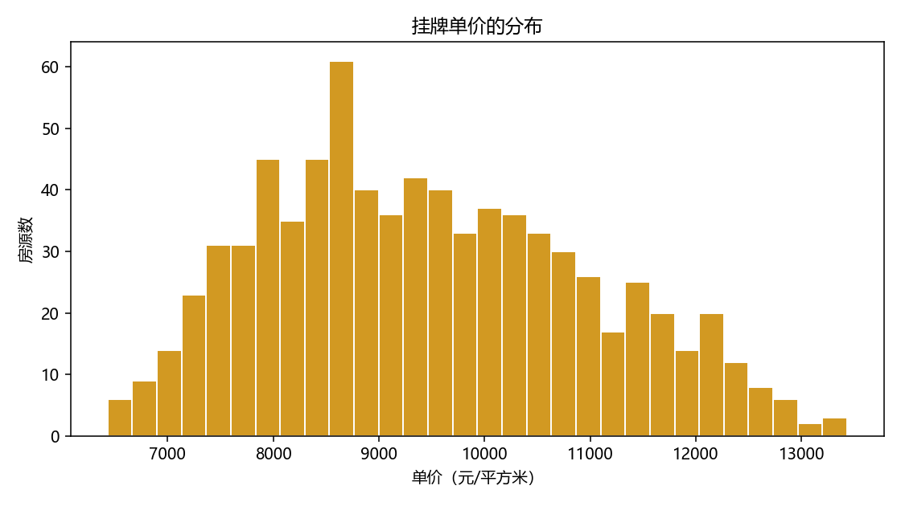
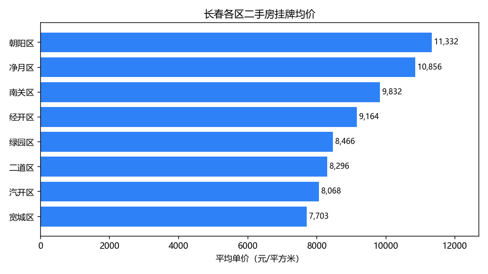
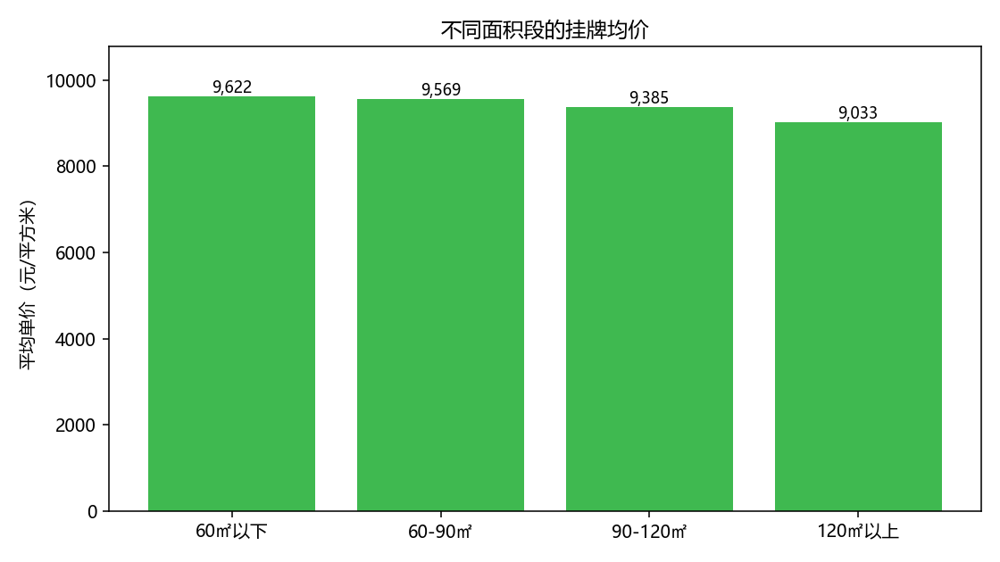

# 长春二手房挂牌数据分析

> 数据来源：示例数据（`python -m src.demo_data` 生成），**不是真实行情**
>
> 这份报告由 `python -m src.pipeline` 自动生成，改 SQL 或换数据后重跑即可。

## 1. 数据概况

- 清洗后房源：**780** 套
- 覆盖区：**8** 个
- 单价中位数：**9,318** 元/平方米
- 总价中位数：**78.9** 万元

### 清洗过程

| 步骤 | 行数变化 |
| --- | --- |
| 原始行数 | 840 |
| 重复删除 | 40 |
| 必填缺失删除 | 16 |
| 面积/总价异常删除 | 4 |
| 单价异常删除 | 0 |
| 最终行数 | 780 |
| 保留比例 | 92.9% |

（其中 14 行单价缺失或明显不对，用「总价 ÷ 面积」重算）

> 看分布比看均值重要：多数分析会在这里发现「双峰」或「长尾」，
> 那才是值得写进结论的东西。

### 字段缺失情况（清洗前）

| 字段 | 缺失数 | 缺失比例 |
| --- | --- | --- |
| total_price_wan | 17 | 0.020 |

## 2. 五个问题

### Q1. 各区均价与房源数

| 区域 | 房源数 | 均价 | 最低价 | 最高价 |
| --- | --- | --- | --- | --- |
| 朝阳区 | 122 | 11,332.0 | 8,767.0 | 13,431.0 |
| 净月区 | 119 | 10,856.0 | 8,344.0 | 13,221.0 |
| 南关区 | 118 | 9,832.0 | 7,829.0 | 12,471.0 |
| 经开区 | 100 | 9,164.0 | 7,304.0 | 11,348.0 |
| 绿园区 | 99 | 8,466.0 | 6,695.0 | 10,253.0 |
| 二道区 | 87 | 8,296.0 | 6,484.0 | 9,939.0 |
| 汽开区 | 69 | 8,068.0 | 6,509.0 | 9,220.0 |
| 宽城区 | 66 | 7,703.0 | 6,433.0 | 9,166.0 |

### Q2. 面积段与均价

| 面积段 | 房源数 | 均价 | 平均面积 |
| --- | --- | --- | --- |
| 60㎡以下 | 108 | 9,622.0 | 50.4 |
| 60-90㎡ | 352 | 9,569.0 | 76.4 |
| 90-120㎡ | 221 | 9,385.0 | 103.0 |
| 120㎡以上 | 99 | 9,033.0 | 143.9 |

### Q3. 楼层高低对单价的影响

| 楼层 | 房源数 | 均价 |
| --- | --- | --- |
| 中楼层 | 321 | 9,538.0 |
| 高楼层 | 233 | 9,537.0 |
| 低楼层 | 226 | 9,258.0 |

### Q4. 房龄与均价

| 房龄段 | 房源数 | 均价 |
| --- | --- | --- |
| 5 年内 | 259 | 9,706.0 |
| 6-10 年 | 210 | 9,548.0 |
| 11-20 年 | 214 | 9,253.0 |
| 20 年以上 | 97 | 9,041.0 |

### Q5. 挂牌量最多的小区

| 小区 | 区域 | 挂牌数 | 均价 | 平均面积 |
| --- | --- | --- | --- | --- |
| 南关54号院 | 南关区 | 7 | 9,922.0 | 84.2 |
| 朝阳09号院 | 朝阳区 | 6 | 11,051.0 | 114.3 |
| 朝阳32号院 | 朝阳区 | 6 | 10,915.0 | 97.9 |
| 朝阳20号院 | 朝阳区 | 5 | 11,504.0 | 104.9 |
| 净月57号院 | 净月区 | 5 | 11,062.0 | 76.1 |
| 朝阳12号院 | 朝阳区 | 5 | 10,864.0 | 98.3 |
| 净月27号院 | 净月区 | 5 | 10,819.0 | 93.5 |
| 净月12号院 | 净月区 | 5 | 10,645.0 | 77.7 |
| 南关30号院 | 南关区 | 5 | 10,396.0 | 75.3 |
| 南关53号院 | 南关区 | 5 | 9,515.0 | 92.6 |

## 3. 结论

> 这一节要你自己写。套路是：一句结论 + 一个数字 + 一个可能的解释。
>
> 例：*净月区均价最高（11,300 元/㎡），比最低的宽城区高 40%，
> 可能和学区、新房供给结构有关，需要分房龄再看一遍。*

- TODO: 结论 1
- TODO: 结论 2
- TODO: 结论 3

## 4. 取舍与局限

- 挂牌价 ≠ 成交价：真实成交通常低于挂牌 5%~10%，这份数据只能看「卖家想要多少」。
- 只用了挂牌时点的截面数据，没有时间序列，无法判断涨跌。
- 学区、地铁、装修这些真正影响价格的因素没有进模型。
- 异常值用固定区间过滤，可能误伤真实的极端房源（比如别墅）。
